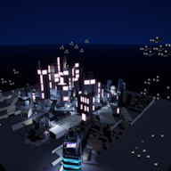

# Cyber City Clock

A real time clock built as an interactive cyberpunk city in **Unreal Engine 5.6**.
Final project for the Unreal Engine course at Reichman University.

## Concept

Instead of a clock face, the time of day is told by the city itself. Every element of the city represents part of the clock:

- **Hours:** hovercrafts flying over the city. The number of active hovercrafts matches the current hour.
- **Minutes:** building windows that light up as the minutes pass.
- **Seconds:** tracked by the clock manager together with the minutes, so the city updates continuously.

The city reads the system time, so it always shows the real current time. A small UI lets you switch to a manual time to preview any hour and minute.

## How it works

| Part | Asset | What it does |
|---|---|---|
| Clock manager | `Content/materialsForCity/BP_ClockCityManager` | Reads the system time (`Now` / `BreakDateTime`) on a timer and drives the minute window lighting |
| Hour manager | `Content/Hovercrafts/BP_HourManager` | Tracks the current hour and activates the matching hovercrafts |
| Hovercraft | `Content/Hovercrafts/free_cyberpunk_hovercar/BP_Hovercraft` | A hovercraft actor with glowing materials (`M_HoverGlow`, `M_HoverGlowG`) |
| Flight paths | `Content/materialsForCity/sequences/` | Level Sequences that move each hovercraft along its route |
| Minute windows | `Content/CyberCity/M_Minute_Master`, `MI_MinuteWindows` | Window material whose intensity reflects the minutes |
| Manual time UI | `Content/materialsForCity/WBP_ManualTime` | UMG widget with hour and minute controls and an Apply button |
| Player controller | `Content/materialsForCity/BP_CityPlayerController` | Connects the UI to the clock and hour managers (`NewHour`, `NewMinute`, `ApplyManualTime`) |
| Game mode | `Content/materialsForCity/BP_CityMode` | Sets up the player controller for the level |
| Level | `Content/CyberCity.umap` | The city scene: buildings, street lamps, cars, night sky and music |

Built with Blueprints, materials and material instances, Level Sequencer and UMG. The Pixel Streaming plugin is enabled so the city can be streamed to a browser.

## Repository contents

This repository contains the parts I created: the level, Blueprints, materials, sequences, UI widget and project config.

Third party assets used in the scene (the city, building, hovercraft, street lamp and car models, their textures, and the music) are **not included**, because they belong to their original creators. Opening the project will show those references as missing.

## Tech

Unreal Engine 5.6 · Blueprints · Materials · Level Sequencer · UMG · Pixel Streaming

## Author

**Kanir Weiss** · [LinkedIn](https://www.linkedin.com/in/kanir-weiss-769635293/)
